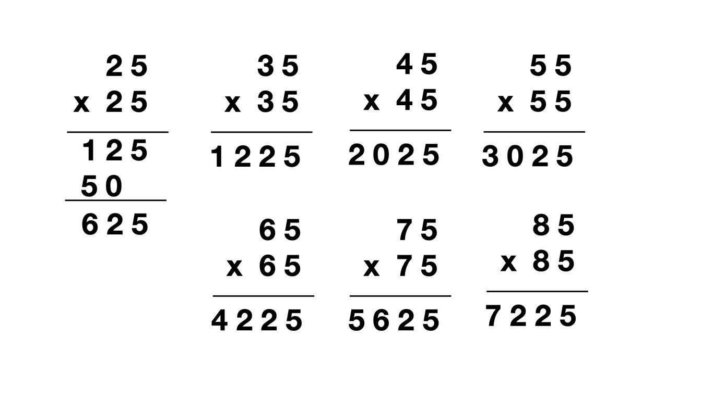

# 1.1 神奇的数

在继续学习本章内容之前，不妨思考一下以下问题：

* 数是怎么产生的？- 你都知道哪些数？

* 你知道哪些数的运算？- 数与图形（几何）又是什么关系？

* 计算机是怎么表示数的？-

* 计算机编程语言跟数有什么联系？

* 数字时代，文字、图像、音视频等，都是怎么用数表示的？

仔细思考这些问题，然后看后面我是怎么思考并解释这些问题的。读完本章之后，再告诉我，你是不是对数有了新的认识，对你都有哪些启发。也希望你能理解，为什么一本编程书，却要从这么简单的数开始讲。

---

我们最常见的数就是诸如1、2、3之类的自然数。说它们是自然数，是因为这些数跟我们日常生活有天然的联系，比如它们可以一一对应到一根手指，或者一支铅笔等（0 也是自然数，只不过它比较特殊，我们本章后面还会讲）。

> 当然，你也很容易想起一些运算，如：\
> 1 + 1 = 2
>
> 1 x 1 = 1
>
> 10 x 10 = 100
>
> 100 x 100 = 10000

还有一些“找规律，填数字的题”，如：

> 1 2 4 8 16 □ 64
>
> 0 1 3 7 15 □ 63

这些数是有规律的。我们很容易地知道，上下两个方框中分别应该填 32 和 31，而且，我们也可以看出，下面的每个数都是奇数，而且，比上面对应的数字都小 1。不过，如果你再仔细观察，就可以发现，下面的每个数，都是它上面的数前面所有数的和，多么神奇啊。

事实上，上面的数都跟 2 有关，也跟 2 的幂有关。计算机是二进制的，因此，熟练记住这些数和规律，对于学习和理解计算机至关重要。当然，在此我们先不管其中的数学原理。下面，我们再来看一组乘法竖式：

从图中可以看出，这组乘法其实很有规律，如下：

* 两个相同的两位数相乘

* 个位数都是5

我们进一步观察可以看到，所有乘积的最后两位都是25，而前面的位置是十位数乘以十位数字加一，以25 x 25为例，乘积的百位数是2 x (2 + 1) = 6，其他的也依此类推。这个例子可以给我们一个直观的印象，那就是，有规律的数字的运算，其实是有窍门的，也就是我们可以找到一些速算方法，这也是数的神奇之处。

 

