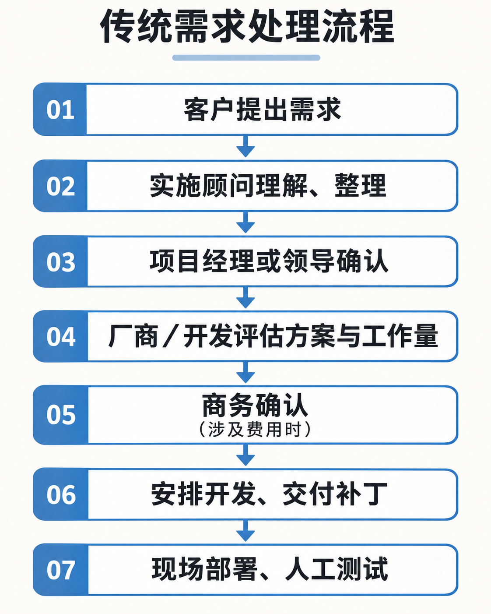

# 一个实施顾问的思考：当 AI 搞定二次开发，ERP 底座化，未来的“软件”与“业财一体化”将去向何方？

我是一个 ERP 实施顾问。日常工作中，需要把客户的业务需求落到系统里，也经常要处理 ERP 与影像等外围系统之间的问题。

最近，我尝试用 AI 完成了一次影像系统的需求修改。

过去，无论是影像还是 ERP，需求大致都要经过这样的流程：

这次，我把已有的程序文件交给了 AI。

这些文件就是平时更新补丁时拿到的后端 JAR 包和前端 ZIP 文件。把需求说明清楚后，AI 很快分析了程序，定位修改位置，完成前端调整，并给出了后端不需要修改的判断，以及数据库需要补充的脚本。

从分析到产出可供测试的修改，整体不到半小时。

后面仍然需要人工测试。功能是否符合要求、其他操作是否受到影响，都需要继续验证。这部分依然比较耗时。所以，这半小时只能说完成了修改，不能算完成了整个需求交付。

但它已经让我对原来的工作方式产生了疑问。

以前遇到这样的需求，我首先想到的是找谁评估、找谁开发、什么时候能拿到补丁。现在，我可以先借助 AI 分析，看看自己能不能把问题推进下去。类似的尝试，我在 ERP 系统上也做过。

过去，实施了解现场，开发负责实现，产品提供底层支持。一个需求在不同角色之间逐步推进，也伴随着反复沟通：补充背景、确认方案、测试后再调整。每次转交，都需要让另一个人重新理解一部分事情。

## 一、当实施顾问可以直接修改系统，原来的分工会怎样变化？

这次实践让我重新看待实施顾问的业务经验。

我们长期在现场，了解客户为什么提出需求、系统实际怎样运行，也能判断修改结果是否符合业务预期。借助 AI，这些经验可以更直接地转化为解决方案，顾问也能够参与更多实现工作。

原来实施与开发之间清晰的职责边界，开始有了变化。对于一部分需求，一个熟悉业务的人，就可以借助 AI 连续完成分析、修改和验证，减少中间的转述与等待。

但实现更快，并不意味着交付自然变快。方案由谁确认、测试由谁组织、修改后由谁持续维护，仍然需要明确。

当一个人借助 AI 能够承担过去多个岗位的部分工作，原有的岗位边界、授权方式和协作层级，也需要重新调整。这已经涉及组织架构的变化。

只是，技术能力的进步，往往快于企业的组织调整。市场上习惯的报价、采购和交付方式，也需要时间改变。于是，个人已经能够更快地解决问题，需求却仍然沿着原来的链条流转，节省下来的开发时间，可能又消耗在等待与协调之中。

这意味着，AI 的应用需要与交付方式一起改变。实施顾问的工作可以向方案设计和结果验证延伸，开发人员则有机会把更多精力放到复杂问题、架构和质量上。

再往前一步，当客户和现场顾问能够自行解决越来越多的需求，厂商又应该提供什么？过去围绕开发人力、需求排期和补丁交付形成的服务方式，是否还足以支撑客户继续付费？

## 二、当二次开发越来越容易，厂商的价值在哪里？

当客户和顾问能够自行解决越来越多的需求，厂商的价值需要重新审视。

历史数据、复杂接口、长期积累的二开，以及更换系统的成本，确实能让客户继续留下。但这些解释的是客户为什么暂时离不开，无法单独回答客户未来为什么还愿意选择你。

厂商积累的行业经验和产品能力仍然有价值。但未来，当客户可以借助 AI 按照自己的需求调整系统时，是否还需要依赖厂商来完成每一次修改？如果这种依赖逐渐减少，厂商又该凭借什么，让客户继续选择自己？

沿着这个方向继续想：未来，企业还会围绕一套固定的软件安排工作吗？还是会根据自身需求，不断构建和调整应用，而 ERP 逐渐成为背后的共同底座？

## 三、未来的“软件”：从 SAP 的转变看起

SAP 已经开始调整软件的构建和使用方式。

一方面，通过 Clean Core 减少对标准核心的直接修改，让个性化需求通过扩展实现，降低升级与维护的影响。另一方面，通过 Joule 和 Joule Studio，让用户用自然语言调用业务能力，也让客户和伙伴构建自己的技能与智能体。

这条路线正在落地：Joule Studio 的自定义技能于 2025 年宣布正式可用；到 2026 年 10 月，SAP 已公布 Joule Work 的部分客户使用情况，但仍有能力处于试点或分阶段推出中。

SAP 的改变，是我们可以借鉴的方向之一：ERP 继续承载标准业务，企业按需扩展应用，AI 则逐渐成为连接人和系统的入口。

软件界面可能逐渐退到后台，应收、应付和会计凭证这些业务记录仍然存在。AI 改变的是处理它们的方式，而业财一体化需要确保：无论由人还是 AI 发起操作，同一笔业务都遵循一致的规则，并能追溯到对应的财务结果。

## 四、未来会变成什么样，我们还不知道

未来的业财一体化，还需要依赖同一套软件吗？还是各单位有自己的应用，底下遵循共同的业务和财务规则？现在还说不准。

AI 已经能做很多事情，但企业的流程、组织和岗位，没有变化得那么快。我们现在感受到的差别，可能只是处在不同的阶段。所以，我知道你很急，但其实也没那么急。只是，如果一直等，等到那把砍刀真正落到自己脖子上的时候，我们又该何去何从？

说到拥抱 AI，也不用想得太大。不是必须用最新的产品，不是所有业务都要 AI 化，也不是一上来就要解决最复杂的问题。

对我们实施顾问来说，先看看手上的需求、每天重复的工作，有没有能让 AI 帮忙的地方。对普通人来说也一样，从自己熟悉的事情开始，想一想，试一试。

未来是什么样子，尚未可知。但用好 AI，我觉得已经是一个必选项。

---

[下载 Word 原稿](../documents/ai-era-business-transformation.docx) · [返回博客目录](../README.md)
